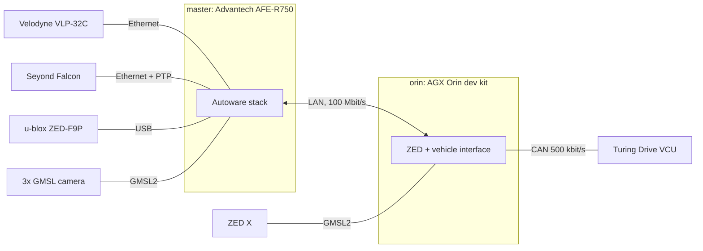

# Golf Cart Autonomous Driving

Autonomous driving for an electric golf cart, built on
[Autoware](https://github.com/autowarefoundation/autoware) 1.5.0 and ROS 2 Humble.
The cart localizes against a point cloud map (NDT), plans along a Lanelet2 map,
and drives through a Turing Drive vehicle control unit (VCU) over CAN.

It is developed at NEWSLab, National Taiwan University, and is in active
development. Autonomous runs are supervised: a driver is always aboard.

## Hardware at a glance

The cart has two computers on one LAN.

| | master | orin |
|---|---|---|
| computer | Advantech AFE-R750 (Jetson AGX Orin) | Jetson AGX Orin dev kit |
| address | `192.168.125.100` | `192.168.125.101` |
| runs | the Autoware stack | ZED X camera, CAN vehicle interface |
| sensors | Velodyne VLP-32C, Seyond Falcon, u-blox ZED-F9P GNSS, 3 TIER IV GMSL cameras | ZED X stereo camera (its IMU is the IMU in use) |
| records to | `recordings/` in the repo, on the external SSD | `recordings/` in the repo (NVMe) |



Full details, known-broken devices and VCU limits: [docs/hardware.md](docs/hardware.md).

## Daily use

Run everything on the **master**, in the repository directory. It starts and
stops the orin for you.

Start the cart's software (both machines):

```bash
just up
```

Start it with a saved set of arguments, for example the Ming-Da basement loop:

```bash
just up @mingda-loop
```

Follow the log, and stop everything:

```bash
just logs
just down
```

`just up` returns at once and the stack keeps running in the background.
Closing the terminal does not stop it; `just down` does.

Record a session on both machines (ROS bags plus raw CAN, under one session ID),
then copy the orin's half to the master:

```bash
just record start [SCOPE] [NAME]   # scopes: drive (default), all, raw, can, ros
just record status
just record stop
just record collect
```

Scopes, where files land and how to open them: [docs/recording.md](docs/recording.md).

**Before any autonomous drive**, follow
[docs/guides/control_testing.md](docs/guides/control_testing.md). The driver puts
the cart in AUTO on the dashboard (brake pedal held, then the AUTO button) before
Autoware engages.

When something does not work:

```bash
just service doctor
```

## Documentation

| | |
|---|---|
| [docs/hardware.md](docs/hardware.md) | what is on the cart, addresses, CAN, known-broken devices |
| [docs/setup.md](docs/setup.md) | installing a machine (once) |
| [docs/operating.md](docs/operating.md) | start/stop, argument files, map and initial pose, RViz, logs, troubleshooting |
| [docs/recording.md](docs/recording.md) | recording sessions (bags, CAN, pcapng): start/stop/collect, scopes, opening and replaying the files |
| [docs/maps.md](docs/maps.md) | downloading and checking maps |
| [docs/guides/control_testing.md](docs/guides/control_testing.md) | supervised autonomous drive: roles, checks, engage order |
| [DEVELOPMENT.md](DEVELOPMENT.md) | for developers: build, single-machine runs, simulators, project layout |
| [docs/README.md](docs/README.md) | index of design notes, roadmaps and research |
| [ROADMAP.md](ROADMAP.md) | the development plan |

`just --list` shows every command.

## License

Apache 2.0. See [LICENSE](LICENSE) and [NOTICE](NOTICE).

## Acknowledgments

Built on [Autoware](https://github.com/autowarefoundation/autoware) by the
Autoware Foundation, and on NEWSLab's Golf Cart / AutoSDV platform at National
Taiwan University.
