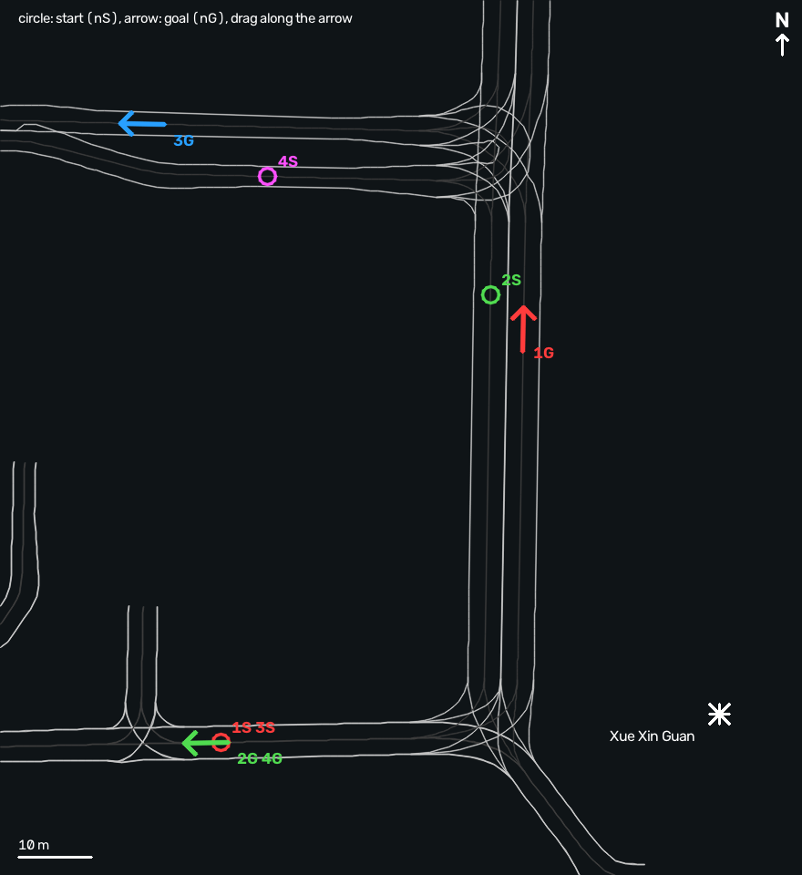

# Running the Isaac twin demo

The cart's own Autoware drives the golf cart in the NTU campus twin on Isaac Sim. The drive
makes one or two turns at the T junction in front of 學新館. The plan and its runs are in
[roadmap 10](../roadmaps/10-isaac-twin-demo.md).

This page assumes newslab-118-server, which is already set up. Run every command from the
repository root. For another host, see [Setting up a new host](#setting-up-a-new-host).

## The demo by one script

`scripts/twin/twin.sh` (or `just twin <command>`) runs the whole demo from a fresh clone:

```bash
scripts/twin/twin.sh setup       # config/twin.env, scenario-world-bridge, the build; then doctor
scripts/twin/twin.sh doctor      # what this host still lacks, and how to get it
scripts/twin/twin.sh help        # every command and option
scripts/twin/twin.sh list        # the routes and scenarios

scripts/twin/twin.sh run                                # free drive from route 1 (Ctrl-C ends it)
scripts/twin/twin.sh go 1                               # second terminal: route 1's goal, engage
scripts/twin/twin.sh run --route 2 --no-perception      # another route, the cart without perception
scripts/twin/twin.sh run --scenario showcase_pedestrian # a scenario: it ends with a verdict
scripts/twin/twin.sh run --showcase                     # every showcase in turn, then the verdicts
scripts/twin/twin.sh stop                               # whatever it started, if a terminal was lost
```

`run` takes `--route N` or `--scenario NAME` (or `--showcase`), and `--no-perception`,
`--no-rviz`, `--headless`, `--fast` (free drive unpaced), `--follow MODE`; anything after `--`
goes to `twin.launch.py` as `name:=value`. `drive`, `scenario` and `showcase` are shortcuts.

The first `setup` writes `config/twin.env` from `config/twin.env.example` and stops: fill in
the host's paths and run it again. It clones scenario-world-bridge into `TWIN_SWB` when it is
absent and builds both workspaces. Isaac Sim, the twin's map and the NPC assets it cannot
fetch; `doctor` names each and how to get it. Verdicts are under `log/twin/scenario/<name>/`.
The rest of this page is what the script does, by hand.

## Before you start

1. Open a VNC viewer on `newslab-118-server:9`. Isaac's window and RViz open there.
2. Check that the host is quiet. The sim slows down with the host: on 2026-11-07 another job's
   load dropped it to 0.2x real time.
   ```bash
   uptime        # load average well under 48
   nvidia-smi    # GPU 0 free: no other large process on it
   ```
3. Check that nothing of the demo is up: no `play_launch` of yours is running.
   ```bash
   pgrep -u $USER -x play_launch    # prints nothing
   ```

## Everything in one launch

scenario-world-bridge's stack starts Isaac Sim, its bridge, the cart's Autoware and RViz with
one command (swb roadmap 073). In one terminal:

```bash
source scripts/twin/setup.bash
play_launch launch golfcart_twin twin.launch.py route:=1          # free drive: you drive
play_launch launch golfcart_twin twin.launch.py scenario:=route1  # SSv2 runs a scenario
```

- **Free drive** (`route:=N`): the cart appears at the route's start and time runs. Set the
  goal and press AUTO in RViz (see [Drive](#drive)), or in a second terminal
  `ros2 run golfcart_twin twin_go.py N`.
- **A scenario** (`scenario:=route1` .. `route4`, or a path to an `.xosc`): SSv2 places the
  cart, routes it to the goal, engages, and judges it. It passes within 2 m of the goal.
  Add `exit_on_scenario_end:=true` to end everything with the scenario, and
  `scenario_args:="output_directory:=<dir>"` to keep its JUnit result. Another scenario on
  the live stack, from a second terminal after `source scripts/twin/setup.bash`:
  ```bash
  ROS_DOMAIN_ID=$SCENARIO_ROS_DOMAIN_ID play_launch launch --web-addr 127.0.0.1:8081 \
      swb_launch scenario.launch.xml port:=$SSV2_PORT \
      scenario:=$(ros2 pkg prefix golfcart_twin)/share/golfcart_twin/scenarios/route2.xosc
  ```
- Time is synchronous either way: the world advances one step per frame. Free drive paces it
  to the wall clock (`realtime:=false`: as fast as it goes); a scenario's pace is SSv2's.
- Other arguments: `render`, `rviz`, `follow` (`true`: no editor UI, the view chases the
  cart), `gpu`, `map_path`.
- The scenarios are made from `config/routes.yaml` by `scripts/make_scenarios.py`, and the
  cart's catalog and spec hash from its spec (`just twin generate`).

### Showcase scenarios

Route 1 with what an OpenSCENARIO script adds (`scripts/make_showcase.py`, `just twin generate`):

| `scenario:=` | What happens | Passes when |
|---|---|---|
| `showcase_pedestrian` | A pedestrian steps off the kerb of the north road when the cart is 20 m away, stops in the cart's lane for 5 s, then walks on across | The cart stops for it, waits, and reaches the goal without coming within 1 m of it |
| `showcase_lead_vehicle` | A car pulls out ahead and drives the same way at 1.5 m/s, on past the goal | The cart follows it without contact and reaches the goal |
| `showcase_traffic` | An oncoming car down the north road, a parked car, two pedestrians on the north road's sidewalks | The cart reaches the goal without contact |

On 118 (2026-11-08) all three passed. In `showcase_pedestrian` the cart braked from 2.5 m/s
to a stop about 5.6 m before the pedestrian and pulled away once the pedestrian was about
4.5 m clear. In `showcase_lead_vehicle` it slowed to the car's 1.5 m/s and kept about 10 m
behind it.

These need the cart's perception: CenterPoint on the lidars, tracking and prediction
(Autoware data in `AUTOWARE_DATA`). `twin.launch.py` runs it (`perception:=true`, the default),
as `logging_simulation.launch.yaml` does. The cart's own `golfcart.launch.yaml` defaults
`launch_perception` to `false`, publishing empty objects; on the cart, add
`launch_perception:=true` (and a `perception_preset`, default `lidar_only`).

Writing your own: a pedestrian or car that must cross the cart's path regardless needs the
controller property `isBlind` set to `true`, or SSv2 stops it for the cart. Walk pedestrians
with `WalkStraightAction` and speed actions rather than a timed trajectory: one started by a
trigger did not move here. An `Action` holds one `PrivateAction`. The cart's declared limits
(`maxSpeed` 3.0, `maxAcceleration` 3.0, `maxDeceleration` 6.0 m/s^2) are bounds SSv2 checks,
not commands: below what the cart does, SSv2 aborts the run. NPC bodies come from the CARLA
catalogue in `SWB_VEHICLE_USD` (twin.env).

The sections below run the pieces apart instead: Isaac's stand-alone runner, the cart's
Autoware, and `twin_go.py`, each in its own terminal.

## Start

Open three terminals at the repository root. Source the demo's environment in each one: it
sources Autoware, swb and this repository, and sets the ROS domain and the DDS profile that
both sides share.

```bash
source scripts/twin/setup.bash
```

It is a bash script: in zsh or fish, run `bash` first. A virtualenv's `python3` on `PATH` would
hide ROS's, so it takes such directories out of `PATH` in that terminal and says so.

It prints the domain, the map, Isaac's install and the display:
`twin: domain 11, map /mnt/renegade/aeon/ntu-twin/map, Isaac /mnt/renegade/aeon/isaac-sim, display :9`.

**Terminal 1: Isaac Sim and the cart** (2 to 3 min)

```bash
play_launch launch golfcart_twin twin_world.launch.py route:=1
```

Isaac's window opens on the display with the campus and the cart on the road at route 1's
start, and its view follows the cart. The node log ends with `sensors warm` when the cart is
ready:

```
ego newslab_golfcart ... at (480.25, 148.25, 11.93); sensors warm
```

Its arguments: `route` (1 to 4), `render` (`auto`: a window when `DISPLAY` is set; `window`
or `headless`), `map_path` (default `$TWIN_MAP`), `gpu` (default `$TWIN_GPU`).

The cart is this repository's: `golfcart_twin/vehicle/newslab_golfcart.yaml` (its spec) and
`golfcart_twin/isaac/` (aib's ego config, the rig generated from the spec, the body and the
lidar profiles, all committed). scenario-world-bridge provides only the Isaac runner
(`aib_launch isaac_vehicle.launch.xml`). After changing the spec, `make_lidars.py` or the
body tools, run `just twin generate` and commit what it writes; `just twin generate --check`
tells whether the rig is stale.

**Terminal 2: the cart's Autoware and RViz** (about 1 min)

```bash
play_launch launch --web-addr 127.0.0.1:8081 golfcart_twin twin_autoware.launch.xml
```

Each play_launch serves a web UI, and terminal 1's took the default port 8080: give this one
its own, or it runs without one. The web UIs are at http://127.0.0.1:8080 (the world) and
http://127.0.0.1:8081 (Autoware).

RViz opens looking straight down on the T junction, north up:

- the lanes are drawn in white;
- the cart sits at its start;
- lidar points surround it;
- the camera image is in the image dock.

Localization initializes itself from the GNSS. The sim plays the cart's u-blox RTK receiver
as a fixed RTK solution at 1 Hz with no noise. Autoware's automatic pose initializer retries
until the GNSS fix and the map are in. Its log shows `The GNSS pose has not arrived` or
`align server failed` once or twice, and this is normal. Within about 10 s of the start, the
Autoware state panel shows the localization as initialized and the operation mode as STOP.
The same holds when only Autoware is restarted, wherever the cart stands.

## Drive

**By hand, in RViz:**

1. Choose **2D Goal Pose** on the toolbar.
2. Press on the route's goal in the picture below, and drag along its arrow to give the
   direction. The planned route and trajectory appear.
3. Press **AUTO** in the Autoware state panel's operation mode. The cart drives off and stops
   at the goal.



The goals, in words:

| Route | Goal |
|---|---|
| 1 | on the north-south road, northbound, about 50 m north of the T |
| 2, 4 | on the east-west road, westbound, about 30 m west of the T |
| 3 | on the north road, westbound, about 45 m west of the north junction |

**Or by script, in terminal 3.** It waits for localization, sets the goal, engages, and
reports until the cart arrives:

```bash
ros2 run golfcart_twin twin_go.py 1
```

It ends with `arrived in 65.8 s, 0.76 m from the goal`.

## Routes

From `src/simulation/golfcart_twin/config/routes.yaml`. Each route is checked against the
twin's lanes, and each stays on scanned ground.

| Route | What it does | Turns | Length |
|---|---|---|---|
| 1 | from the west, left at the T, north | 1 | 89.5 m |
| 2 | from the north, right at the T, west | 1 | 92.1 m |
| 3 | from the west, left at the T, left again at the north junction, west | 2 | 163.6 m |
| 4 | the north road eastbound, right to the south, right again at the T, west | 2 | 135.8 m |

The cart drives at up to 2.5 m/s; route 1 takes under a minute. Route 4's first right turn
is tight: its radius is 4.5 m, against the cart's 3.6 m minimum.

To drive another route, start again from that route's start: stop both launches, then start
terminal 1 with `route:=3` and terminal 2 as before.

## Stop

Press Ctrl-C in terminal 2 (Autoware), then in terminal 1 (Isaac Sim). Each play_launch
stops its nodes and exits.

## Recipes

`just twin` runs the same launches in the background, with logs in `log/twin/`:

```bash
just twin drive 1     # the whole stack, as scripts/twin/twin.sh drive
just twin showcase    # the showcase scenarios and their verdicts
just twin world 1     # terminal 1's launch
just twin autoware    # terminal 2's
just twin go 1        # twin_go.py
just twin status
just twin stop        # Autoware, then Isaac Sim
```

## When it does not work

| Symptom | Likely cause | What to do |
|---|---|---|
| The cart does not move | No route, no engage, or localization not initialized | Set the goal again; press AUTO; wait until the state panel shows localization initialized |
| RViz shows nothing, or no cart | RViz and the sim do not see each other: a different ROS domain or DDS profile | Source `scripts/twin/setup.bash` in both terminals: it gives both the package's `cyclonedds-unicast-lo.xml` and `TWIN_DOMAIN` |
| `Web server error: Address already in use` | Two play_launch on one web port | Harmless: the launch runs without its web UI. Give the second one `--web-addr 127.0.0.1:8081` |
| Localization stays uninitialized | No GNSS fix or no map: terminal 1 not up, or a different domain | Check `ros2 topic hz /sensing/gnss/ublox/nav_sat_fix` (about 1 Hz) in terminal 3 |
| The sim runs slowly | Host load | Check `uptime` and `nvidia-smi`; wait for the other job |
| `world` takes over 10 min | The first start on a host compiles shaders | Let it finish once; later starts are quick |
| The cart goes faster than 2.5 m/s | The sim's speed ceiling is missing. Like the cart's VCU, it is the motor's top speed in swb's `newslab_golfcart` spec (sim_vehicle_spec 62ac087 or later). Autoware itself plans up to 4.17 m/s: its 2.5 default does not reach the planner (roadmap 10) | In `TWIN_SWB`, `git pull` and `git submodule update --init --recursive`, then restart the world |
| `world` or `autoware` says it is already up, or a second Isaac window | An earlier run is still alive | Ctrl-C it, or `just twin stop` |

Each play_launch logs to `play_log/<time>/` of the directory it was started in (`play_log/latest/node/<node>/out` and `err`); `just twin` logs to `log/twin/`.

## Setting up a new host

1. Install scenario-world-bridge (swb) and build it at its pins. It holds aib, the Isaac side.
   Install Isaac Sim 6.1 with swb's `src/swb_isaac_world/scripts/install_isaac.sh`.
2. Copy the twin's map directory to a local disk. It holds:
   - `lanelet2_map.osm`;
   - `pointcloud_map/` with `pointcloud_map_metadata.yaml`;
   - `map_projector_info.yaml`;
   - `isaac/world.yaml`.

   Do not run it from the NAS: a dropped mount takes the map loaders down.
3. Write `config/twin.env` (git-ignored; `config/twin.env.example` is the template, and
   `scripts/twin/twin.sh setup` copies it). `scripts/twin/setup.bash` reads it:
   ```bash
   TWIN_SWB=$HOME/repos/carla-scenario-bridge    # the swb checkout
   ISAAC_ROOT=/mnt/disk1/isaac-sim                # Isaac Sim 6.1
   TWIN_MAP=/path/to/ntu-twin/map                 # the local map directory
   TWIN_DOMAIN=1                                  # ROS domain for both sides, at most 57
   TWIN_DISPLAY=:9                                # Isaac's window; empty runs headless
   TWIN_GPU=0                                     # the GPU Isaac renders on
   AUTOWARE_DATA=$HOME/autoware_data              # Autoware's models, writable
   AUTOWARE_TENSORRT_LIB=/path/to/tensorrt-10.8.0/lib   # swb's setting; avoids engine rebuilds
   ```
4. Build:
   ```bash
   just build
   ```
5. The first world launch compiles Isaac's
   shaders. The first Autoware launch builds the CenterPoint engines in `AUTOWARE_DATA`. Both
   take minutes, once.
