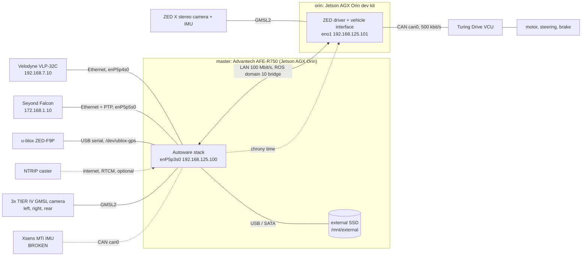

# Hardware

The cart carries two computers on one LAN. The **master** runs Autoware and most
sensors. The **orin** runs the ZED X camera and talks to the vehicle over CAN.
Both hold the same repository and run the same commands.



Dashed lines are optional or not working.

## master

Advantech AFE-R750, a Jetson AGX Orin module running JetPack 6.2 (Ubuntu 22.04,
ROS 2 Humble, Autoware 1.5.0). It runs the whole Autoware stack.

| device | connection | address / device | notes |
|---|---|---|---|
| LAN to the orin | Ethernet `enP5p3s0` | `192.168.125.100` | the link negotiates 100 Mbit/s |
| Velodyne VLP-32C LiDAR | Ethernet `enP5p4s0` (`192.168.7.1`) | `192.168.7.10` | main LiDAR for localization |
| Seyond Falcon LiDAR | Ethernet `enP5p5s0` (`172.168.1.1`) | `172.168.1.10`, port 8010 | time synced over PTP (`ptp4l` + `phc2sys` on `enP5p5s0`) |
| u-blox ZED-F9P GNSS | USB serial | `/dev/ublox-gps` | RTK over NTRIP is optional: `use_ntrip:=true` |
| 3 TIER IV GMSL cameras (imx390) | GMSL2, direct to the Jetson capture unit | left, right, rear | driver `gmslcam`; addressed by `/dev/v4l/by-path/platform-tegra-capture-vi-video-index{12,0,10}` (left, right, rear) in the sensor kit's `camera_*.yaml` |
| Xsens MTi IMU | CAN `can0` | | **broken**, publishes nothing |
| external SSD | | `/mnt/external` | bags go to `/mnt/external/rosbags` |

The master's own disk is a small eMMC (54 GB) that is about 90% full. Do not
record to it. See [recording.md](recording.md).

## orin

A Jetson AGX Orin developer kit with an NVMe disk (about 900 GB).

| device | connection | address / device | notes |
|---|---|---|---|
| LAN to the master | Ethernet `eno1` | `192.168.125.101` (ssh user `jetson`) | |
| ZED X stereo camera | GMSL2 | | its built-in IMU is the IMU in use (`imu_source:=zed`, the default) |
| Turing Drive VCU | CAN `can0` on the 40-pin header, 500 kbit/s | | the vehicle interface runs here |

The orin is started and stopped from the master (`just up`, `just down`). If it
loses the master for about 42 s, it stops itself.

## How the two talk

- One LAN, but each machine runs its stack in its own ROS domain (master 50,
  orin 60). Only a small list of topics crosses, in ROS domain 10, through the
  `golfcart_domain_bridge` node. The list is `config/link/topics.yaml`.
- The vehicle commands go master to orin, and the vehicle status comes back.
  If the link drops, commands stop, and the vehicle interface brakes after
  500 ms.
- The master serves time to the orin with chrony. See
  [Time sync](multi-machine.md#time-sync).

Details: [multi-machine.md](multi-machine.md).

### 4G router

Both hosts take the cart LAN by DHCP: the master's "4G LAN" profile and the
orin's "4G router" profile set no address (`setup/host/`). The fixed addresses
come from DHCP reservations on the 4G router, and nothing in the repo can
restore them. A replacement router needs these set by hand:

| host | interface | MAC | reserved address |
|---|---|---|---|
| master | `enP5p3s0` | `74:FE:48:B3:B1:12` | `192.168.125.100` |
| orin | `eno1` | `48:B0:2D:E6:E5:AE` | `192.168.125.101` |

Gateway `192.168.125.1`. Without the reservations each host gets whatever
lease the router hands out. Then ssh to the orin (`config/multi_machine.conf`),
`on_orin.sh` and everything started from it (`just up`, `just down`, the orin
watchdog, `just host diff --orin`), the orin's chrony source, and the address
and peer the DDS profiles bind (`config/cyclonedds/master.xml`) all point at an
address nobody holds. The two
stacks come up, but they never meet.

## The vehicle: Turing Drive VCU

The vehicle interface sends commands to the VCU over CAN and reads its reports.
It always transmits; the cart's power switch is the master enable.

**AUTO mode is set only on the dashboard.** The driver holds the brake pedal and
presses the AUTO button, before Autoware engages, and does the same to leave
AUTO. Nothing over CAN changes the mode.

To see what the VCU reports and what we send (receive only, safe at any time):

```bash
just can vcu-status
```

Known VCU limits:

| issue | effect |
|---|---|
| Steering report (`0x102`) reads 0 for left turns | vendor bug. Watch the wheels, not `/vehicle/status/steering_status` |
| Speed signals are whole km/h | the report is coarse; the interface converts to m/s |
| `min_speed_mps: 1.5` | whenever the cart moves, it moves at 5.4 km/h or faster, whatever the planner asks. The ceiling is `max_speed_mps: 2.5` (9 km/h) |
| Right steering stops at about 22 degrees | the mechanical limit is less than the left side |

Detail and status: [Phase 9 roadmap](roadmaps/9-mingda-autonomous-driving.md).

## Not on the cart

Older documents mention a Tamagawa IMU, USB cameras, an F9R GNSS and a PWM motor
controller. None of these are on this cart.
